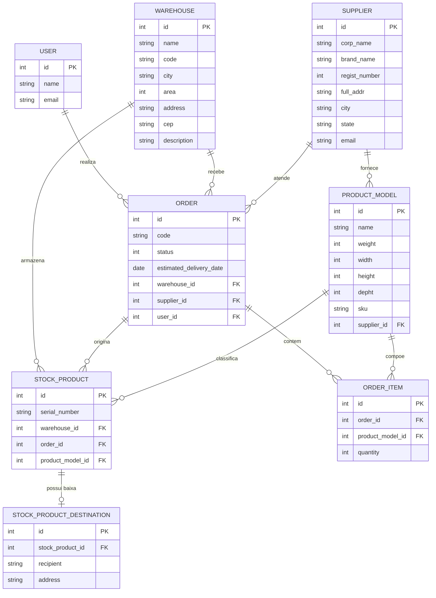

# 📦 Warehouse App (Galpões & Estoque)

[](https://www.ruby-lang.org/)
[](https://rubyonrails.org/)
[](https://www.sqlite.org/)
[](https://getbootstrap.com/)
[](https://rspec.info/)
[](https://www.campuscode.com.br/)

O **Warehouse App** é uma aplicação web completa para gestão logística de galpões, fornecedores, modelos de produtos, ordens de compra e controle de estoque individualizado.

> 🎓 **Sobre o Projeto**: Esta aplicação foi desenvolvida como exercício e projeto prático ao longo do curso **"Quero Ser Dev 40+"** promovido pela [Campus Code](https://www.campuscode.com.br/). O projeto contempla desde os conceitos fundamentais de desenvolvimento web com **Ruby on Rails** e **TDD (Test-Driven Development)** com RSpec e Capybara, até a implementação de autenticação com Devise, fluxos de regras de negócio, construção de APIs RESTful e esteira de CI no GitLab.

---

## 📑 Sumário

- [Visão Geral e Contexto](#-visão-geral-e-contexto)
- [Funcionalidades Principais](#-funcionalidades-principais)
- [Modelo de Dados](#-modelo-de-dados)
- [Tecnologias Utilizadas](#-tecnologias-utilizadas)
- [API REST (v1)](#-api-rest-v1)
- [Pré-requisitos](#-pré-requisitos)
- [Como Configurar e Executar](#-como-configurar-e-executar)
- [Executando os Testes](#-executando-os-testes)
- [Auditoria e Segurança](#-auditoria-e-segurança)
- [Integração Contínua (CI)](#-integração-contínua-ci)

---

## 🔍 Visão Geral e Contexto

O objetivo do sistema é atender às operações logísticas de um ecossistema de armazenamento:
1. Cadastrar e gerenciar **galpões** espalhados por diversas localidades.
2. Cadastrar **fornecedores** parceiros e seus respectivos **modelos de produtos**.
3. Gerenciar **pedidos de compra/suprimento** com itens vinculados e datas previstas de entrega.
4. Ao entregar um pedido, realizar a **entrada automática no estoque** do galpão, com geração de número de série individual para cada unidade de produto.
5. Permitir a **baixa/saída de produtos** do galpão com indicação de destinatário e endereço de entrega.
6. Disponibilizar endpoints de **API REST** para integração com outros sistemas e serviços.

---

## 🚀 Funcionalidades Principais

### 🏢 Galpões (Warehouses)
- **Gestão completa (CRUD)**: Cadastro, listagem, edição, detalhamento e exclusão de galpões.
- **Informações**: Nome, código único de identificação (ex: `SDU`, `GRU`), cidade, área em m², endereço completo, CEP e descrição.
- **Visualização de Estoque**: Na tela do galpão, é possível visualizar o saldo de cada modelo de produto disponível.
- **Expedição/Baixa de Estoque**: Formulário para registrar a saída de itens disponíveis informando o destinatário e o endereço de destino.

### 🏭 Fornecedores (Suppliers)
- **Cadastro e Listagem**: Gestão de empresas fornecedoras com validações de dados obrigatórios e unicidade de CNPJ/registro.
- **Informações**: Razão Social, Nome Fantasia, CNPJ/Número de Registro, Endereço, Cidade, Estado e E-mail.
- **Relação com Produtos**: Visualização dos modelos de produtos vinculados a cada fornecedor.

### 📦 Modelos de Produtos (Product Models)
- **Cadastro e Catálogo**: Associação direta a um fornecedor.
- **Especificações Técnicas**: Nome, peso (g), dimensões (altura, largura e profundidade em cm) e código SKU exclusivo.

### 📑 Pedidos de Suprimento (Orders)
- **Abertura de Pedidos**: Usuários autenticados podem criar pedidos selecionando o galpão de destino e o fornecedor.
- **Código Automático**: Geração aleatória de código de rastreamento com 8 caracteres alfanuméricos em maiúsculas (ex: `A8D9F2KL`).
- **Validação de Prazo**: A data estimada de entrega deve obrigatoriamente estar no futuro.
- **Itens do Pedido**: Inclusão de múltiplos modelos de produtos do fornecedor e suas respectivas quantidades.
- **Ciclo de Vida / Status**:
  - `Pendente` (`pending`): Pedido recém-aberto e em processamento.
  - `Entregue` (`delivered`): Ao ser marcado como entregue, o sistema dá **entrada automática no estoque** do galpão, gerando instâncias de produtos com **números de série exclusivos de 20 caracteres**.
  - `Cancelado` (`canceled`): O pedido é cancelado sem entrada em estoque.
- **Busca de Pedidos**: Campo de pesquisa rápida por código do pedido na barra de navegação.
- **Segurança**: Cada usuário visualiza e gerencia estritamente os seus próprios pedidos.

### 🔐 Autenticação e Segurança (Users)
- Autenticação implementada via gem **Devise**.
- Cadastro de novos usuários com nome, e-mail e senha.
- Proteção de rotas restritas a usuários autenticados (como gestão de pedidos e catálogo de modelos de produtos).

### 🌐 API RESTful (v1)
- API versionada sob o namespace `/api/v1/warehouses`.
- Permite consultar e cadastrar galpões remotamente com respostas em formato JSON e códigos HTTP adequados (`200 OK`, `201 Created`, `404 Not Found`, `412 Precondition Failed`, `500 Internal Server Error`).

---

## 📊 Modelo de Dados

O diagrama abaixo ilustra a relação entre as entidades do sistema:



---

## 🛠 Tecnologias Utilizadas

- **[Ruby 3.1.2](https://www.ruby-lang.org/)**: Linguagem de programação dinâmica e orientada a objetos.
- **[Ruby on Rails 7.0.4](https://rubyonrails.org/)**: Framework web seguindo o padrão MVC (Model-View-Controller).
- **[SQLite 3](https://www.sqlite.org/)**: Banco de dados relacional para desenvolvimento e testes.
- **[Puma 5.0](https://puma.io/)**: Servidor HTTP para Ruby.
- **[Devise](https://github.com/heartcombo/devise)**: Solução flexível para autenticação de usuários.
- **[Bootstrap](https://getbootstrap.com/)**: Framework CSS para estilização e responsividade.
- **[Importmap Rails](https://github.com/rails/importmap-rails)**: Gerenciamento de módulos JavaScript modernos sem necessidade de Node.js/bundlers complexos.
- **[RSpec Rails](https://github.com/rspec/rspec-rails)**: Framework de testes automatizados para Ruby e Rails.
- **[Capybara](https://github.com/teamcapybara/capybara)**: Testes de sistema simulando a interação do usuário no navegador.
- **[Bundler Audit](https://github.com/rubysec/bundler-audit)**: Auditoria e checagem de vulnerabilidades conhecidas em dependências do Gemfile.
- **[GitLab CI](https://docs.gitlab.com/ee/ci/)**: Automação de pipelines de build, testes e segurança.

---

## 🔌 API REST (v1)

A aplicação fornece endpoints JSON sob o caminho base `/api/v1`:

### Endpoints Disponíveis

| Método | Endpoint | Descrição | Códigos HTTP |
|---|---|---|---|
| `GET` | `/api/v1/warehouses` | Retorna todos os galpões cadastrados, ordenados por nome | `200`, `500` |
| `GET` | `/api/v1/warehouses/:id` | Retorna os detalhes de um galpão específico | `200`, `404` |
| `POST` | `/api/v1/warehouses` | Cadastra um novo galpão via payload JSON | `201`, `412`, `500` |

### Exemplos de Requisição

#### Listar Galpões
```bash
curl -X GET http://localhost:3000/api/v1/warehouses
```

#### Buscar Galpão por ID
```bash
curl -X GET http://localhost:3000/api/v1/warehouses/1
```

**Exemplo de Resposta (`200 OK`):**
```json
{
  "id": 1,
  "name": "Aeroporto SP",
  "code": "GRU",
  "city": "Guarulhos",
  "area": 100000,
  "address": "Avenida Monteiro Lobato, 1000",
  "cep": "07111-000",
  "description": "Galpão logístico internacional próximo ao aeroporto"
}
```

#### Cadastrar Galpão
```bash
curl -X POST http://localhost:3000/api/v1/warehouses \
  -H "Content-Type: application/json" \
  -d '{
    "warehouse": {
      "name": "Santos Log",
      "code": "SSZ",
      "city": "Santos",
      "area": 85000,
      "address": "Rua do Porto, 250",
      "cep": "11010-000",
      "description": "Galpão voltado para cargas marítimas"
    }
  }'
```

---

## 📋 Pré-requisitos

Antes de iniciar, certifique-se de ter instalado em sua máquina:
- **Git**
- **Ruby 3.1.2** (gerenciado preferencialmente via [RVM](https://rvm.io/), [rbenv](https://github.com/rbenv/rbenv) ou [asdf](https://asdf-vm.com/))
- **Bundler** (`gem install bundler`)
- **SQLite 3** (`libsqlite3-dev` em distribuições Linux baseadas em Debian/Ubuntu)

---

## 💻 Como Configurar e Executar

### 1. Clonar o repositório
```bash
git clone https://gitlab.com/<seu-usuario>/warehouse-app.git
cd warehouse-app
```

### 2. Configurar o ambiente (script automatizado)
A aplicação conta com um script automatizado que instala as dependências, prepara o banco de dados e limpa arquivos temporários:
```bash
bin/setup
```

*(Ou configure manualmente se preferir)*:
```bash
# Instalar as gems
bundle install

# Criar e migrar o banco de dados SQLite
bin/rails db:prepare
```

### 3. Iniciar o servidor
```bash
bin/rails server
```

Acesse a aplicação no navegador em:
```
http://localhost:3000
```

---

## 🧪 Executando os Testes

O projeto foi construído seguindo a prática de **TDD (Test-Driven Development)**, contando com uma suíte de testes completa cobrindo modelos, requisições de API e fluxos de sistema.

Para rodar todos os testes com RSpec:
```bash
bundle exec rspec
```

Para rodar categorias específicas de testes:
```bash
# Testes de sistema (Capybara e fluxos de interface)
bundle exec rspec spec/system

# Testes de modelos (regras de negócio e validações)
bundle exec rspec spec/models

# Testes de requisição / API
bundle exec rspec spec/requests
```

---

## 🛡 Auditoria e Segurança

O projeto utiliza o `bundler-audit` para analisar as dependências e checar eventuais vulnerabilidades de segurança catalogadas:

```bash
gem install bundler-audit
bundle-audit check --update
```

---

## 🔄 Integração Contínua (CI)

O repositório possui uma esteira configurada no arquivo `.gitlab-ci.yml`, dividida em 3 etapas (*stages*):

1. **Build (`setup`)**:
   - Executa `bin/setup` para instalar dependências e preparar o ambiente.
2. **Test (`rspec`)**:
   - Executa a suíte de testes completa (`bundle exec rspec`) garantindo que nenhuma alteração quebre as funcionalidades existentes.
3. **Security (`audit`)**:
   - Executa a ferramenta `bundle-audit` para verificação de segurança das gems.

---

## 🤝 Créditos e Agradecimentos

Projeto desenvolvido com base nas aulas e exercícios práticos do programa **Quero Ser Dev 40+** da **[Campus Code](https://www.campuscode.com.br/)**, dedicado a acelerar a formação de pessoas desenvolvedoras com foco em boas práticas de mercado, TDD e ecossistema Ruby on Rails.
